# Modèle de classes Hubpieces — lecture guidée

Ce document décrit **le modèle réellement présent dans le dépôt** (`src/main/java/com/hubpieces/model/`, les annotations JPA et `src/main/resources/static/DB/hubpieces_db.sql`). Le bloc Mermaid est la représentation complète des tables métier, de leurs PK/FK et de leurs associations. Il peut être copié dans un visualiseur Mermaid ou conservé dans un README compatible Mermaid.

> Les colonnes PK/FK listées sont celles de la base. Les relations indiquent les contraintes et les cardinalités; `utilisateur_role` est une vraie table d'association générée par le `@ManyToMany` de `Utilisateur` (pas une entité Java séparée).

## 1. Diagramme Mermaid complet

```mermaid
classDiagram
    direction LR

    class Utilisateur {
        +Long id
        +String nom
        +String prenom
        +String email
        +String mot_de_passe
        +String telephone
        +String ville
        +String code_postal
        +Double latitude
        +Double longitude
        +Double note_moyenne
        +Integer nombre_avis
        +StatutUtilisateur statut
        +LocalDateTime date_inscription
        +String photo_profil
    }

    class Role {
        +Long id
        +RoleNom nom
    }

    class UtilisateurRole {
        +Long utilisateur_id
        +Long role_id
    }

    class ProfilMaker {
        +Long id
        +Long utilisateur_id
        +Integer rayon_action_km
        +String materiaux_disponibles
        +String description_imprimante
        +Integer nombre_commandes_actives
        +Integer nombre_avis_positifs
        +BadgeMaker badge
    }

    class ProfilExpertCao {
        +Long id
        +Long utilisateur_id
        +String logiciels_maitrise
        +String portfolio_url
        +String description
    }

    class Demande {
        +Long id
        +String titre
        +String description
        +String marque
        +String modele_appareil
        +String materiau_souhaite
        +Double budget_max
        +String ville
        +String code_postal
        +Double latitude
        +Double longitude
        +EtatDemande etat
        +LocalDateTime date_creation
        +LocalDateTime date_modification
        +Long demandeur_id
        +Long fichier_stl_id
    }

    class FichierStl {
        +Long id
        +String nom
        +String description
        +String chemin_fichier
        +Long taille_fichier
        +String categorie
        +String tags
        +String marque
        +String modele_appareil
        +String materiau_recommande
        +String dimensions
        +Double note_moyenne
        +Integer nombre_telechargements
        +EtatValidation etat_validation
        +LocalDateTime date_upload
        +Long uploadeur_id
        +Long valideur_id
    }

    class PhotoDemande {
        +Long id
        +Long demande_id
        +String chemin_photo
        +LocalDateTime date_upload
    }

    class OffreMaker {
        +Long id
        +Long demande_id
        +Long maker_id
        +Double prix
        +Integer delai_jours
        +String message
        +ModeLivraison mode_livraison
        +EtatOffre etat
        +LocalDateTime date_creation
    }

    class Message {
        +Long id
        +Long demande_id
        +Long expediteur_id
        +Long destinataire_id
        +String contenu
        +Boolean lu
        +LocalDateTime date_envoi
    }

    class Transaction {
        +Long id
        +Long offre_maker_id
        +Double montant_total
        +Double commission_plateforme
        +Double montant_maker
        +Double montant_expert_cao
        +EtatPaiement etat_paiement
        +LocalDateTime date_paiement
        +LocalDateTime date_liberation
        +LocalDateTime date_creation
    }

    class Avis {
        +Long id
        +Long transaction_id
        +Long auteur_id
        +Long destinataire_id
        +Integer note
        +String commentaire
        +Boolean publie
        +LocalDateTime date_creation
        +LocalDateTime date_publication
    }

    class Litige {
        +Long id
        +Long transaction_id
        +Long demandeur_id
        +String raison
        +EtatLitige etat
        +String decision
        +LocalDateTime date_ouverture
        +LocalDateTime date_resolution
        +Long admin_id
    }

    class Notification {
        +Long id
        +Long utilisateur_id
        +String titre
        +String message
        +TypeNotification type
        +Boolean lu
        +LocalDateTime date_creation
    }

    class RoleNom {
        <<enumeration>>
        DEMANDEUR
        MAKER
        EXPERT_CAO
        ADMIN
    }
    class StatutUtilisateur {
        <<enumeration>>
        ACTIF
        SUSPENDU
        EN_ATTENTE
    }
    class EtatDemande {
        <<enumeration>>
        NOUVELLE
        MODELISATION_REQUISE
        RECHERCHE_MAKER
        ATTENTE_IMPRESSION
        EN_COURS_IMPRESSION
        ATTENTE_VALIDATION
        ANNULEE
        CLOTUREE
    }
    class EtatValidation {
        <<enumeration>>
        EN_ATTENTE
        VALIDE
        REJETE
    }
    class EtatOffre {
        <<enumeration>>
        EN_ATTENTE
        ACCEPTEE
        REFUSEE
        ANNULEE
    }
    class EtatPaiement {
        <<enumeration>>
        EN_ATTENTE
        PAYE
        EN_SEQUESTRE
        LIBERE
        REMBOURSE
        LITIGE
    }
    class EtatLitige {
        <<enumeration>>
        OUVERT
        EN_COURS
        RESOLU
        FERME
    }
    class ModeLivraison {
        <<enumeration>>
        REMISE_EN_MAIN
        LIVRAISON_POSTALE
    }
    class BadgeMaker {
        <<enumeration>>
        DEBUTANT
        CONFIRME
        EXPERT
    }
    class TypeNotification {
        <<enumeration>>
        INFO
        SUCCESS
        WARNING
        ERROR
    }

    Utilisateur "1" <-- "0..*" UtilisateurRole : utilisateur_id PK/FK
    Role "1" <-- "0..*" UtilisateurRole : role_id PK/FK

    Utilisateur "1" <-- "0..1" ProfilMaker : utilisateur_id FK UNIQUE NOT NULL
    Utilisateur "1" <-- "0..1" ProfilExpertCao : utilisateur_id FK UNIQUE NOT NULL

    Utilisateur "1" <-- "0..*" Demande : demandeur_id FK NOT NULL
    Demande "0..*" o-- "0..1" FichierStl : fichier_stl_id FK NULL
    Demande "1" *-- "0..*" PhotoDemande : demande_id FK / cascade ALL + orphanRemoval
    Demande "1" *-- "0..*" OffreMaker : demande_id FK / cascade ALL + orphanRemoval
    Demande "1" *-- "0..*" Message : demande_id FK / cascade ALL + orphanRemoval

    Utilisateur "1" <-- "0..*" OffreMaker : maker_id FK NOT NULL
    Utilisateur "1" <-- "0..*" FichierStl : uploadeur_id FK NOT NULL
    Utilisateur "0..1" <-- "0..*" FichierStl : valideur_id FK NULL
    Utilisateur "1" <-- "0..*" Message : expediteur_id FK NOT NULL
    Utilisateur "1" <-- "0..*" Message : destinataire_id FK NOT NULL
    Utilisateur "1" <-- "0..*" Notification : utilisateur_id FK NOT NULL
    Utilisateur "1" <-- "0..*" Avis : auteur_id FK NOT NULL
    Utilisateur "1" <-- "0..*" Avis : destinataire_id FK NOT NULL
    Utilisateur "1" <-- "0..*" Litige : demandeur_id FK NOT NULL
    Utilisateur "0..1" <-- "0..*" Litige : admin_id FK NULL

    OffreMaker "1" <-- "0..1" Transaction : offre_maker_id FK UNIQUE NOT NULL
    Transaction "1" <-- "0..*" Avis : transaction_id FK NOT NULL
    Transaction "1" <-- "0..*" Litige : transaction_id FK NOT NULL
```

## 2. Comment lire les cardinalités

Dans une association écrite `A "x" --> "y" B`, la multiplicité près de **B** se lit « combien de B peuvent être liés à un A » et celle près de **A** se lit en sens inverse. Les noms des FK dans les libellés sont ceux de la base.

| Association | Cardinalité métier | Pourquoi |
|---|---|---|
| `Utilisateur` — `Demande` | un utilisateur demandeur peut avoir 0..N demandes; une demande a exactement 1 demandeur | `demande.demandeur_id` est `NOT NULL` |
| `Demande` — `FichierStl` | une demande référence 0..1 fichier; un fichier peut être référencé par 0..N demandes | `fichier_stl_id` est nullable et n'est pas unique |
| `Demande` — `PhotoDemande` | une demande a 0..N photos; une photo appartient à 1 demande | `photo_demande.demande_id` est `NOT NULL` |
| `Demande` — `OffreMaker` | une demande a 0..N offres; une offre concerne 1 demande | `offre_maker.demande_id` est `NOT NULL` |
| `Utilisateur` — `OffreMaker` | un maker propose 0..N offres; une offre a 1 maker | `offre_maker.maker_id` est `NOT NULL` |
| `OffreMaker` — `Transaction` | une offre a 0..1 transaction; une transaction a exactement 1 offre | `transaction.offre_maker_id` est `NOT NULL` et `UNIQUE` |
| `Transaction` — `Avis` / `Litige` | une transaction peut avoir 0..N avis et 0..N litiges; chaque ligne dépend d'une transaction | FK `NOT NULL`; le schéma n'impose pas d'unicité par auteur |
| `Utilisateur` — `Role` | N..N, matérialisé par `utilisateur_role` | PK composite `(utilisateur_id, role_id)` |
| `Utilisateur` — profils | un compte a 0..1 profil maker et 0..1 profil expert; chaque profil référence exactement 1 utilisateur | FK `utilisateur_id NOT NULL UNIQUE` dans chaque profil |

`0..1` signifie facultatif; `1` signifie exactement un; `0..*` signifie zéro, un ou plusieurs.

## 3. Agrégation, composition et associations simples

- **Composition `*--` — réellement configurée dans JPA** : `Demande` compose ses `PhotoDemande`, `OffreMaker` et `Message`. Côté `Demande`, les relations `@OneToMany` déclarent `cascade = CascadeType.ALL` et `orphanRemoval = true` : ces lignes enfants suivent le cycle de vie de la demande dans Hibernate.
- **Agrégation `o--` — modèle/fichier réutilisable** : une demande peut pointer vers un `FichierStl` du catalogue. La relation réelle est `@ManyToOne` sans cascade, le FK est nullable et non unique : le fichier existe indépendamment de la demande et peut être partagé. Le losange ouvert exprime ce lien faible, il ne signifie pas suppression en cascade.
- **Associations simples `-->`** : profils, transaction/offre, auteurs, destinataires, maker, notifications et rôles. Elles ne sont pas transformées artificiellement en composition parce qu'une FK existe.

> JPA exécute les cascades de composition lorsqu'on supprime une entité par Hibernate. Le dump SQL ne déclare pas `ON DELETE CASCADE` : une suppression directe en SQL ne reproduit donc pas cette règle applicative. De même, les profils sont liés en `@OneToOne` mais n'ont pas de `cascade`/`orphanRemoval`; le diagramme les montre en association simple.

## 4. PK, FK, unicité et points à retenir

- Toutes les entités métier ont une PK `id` générée par identité, sauf `utilisateur_role`, dont la PK est composée de `(utilisateur_id, role_id)`.
- `utilisateur.email` est `UNIQUE`.
- `profil_maker.utilisateur_id` et `profil_expert_cao.utilisateur_id` sont des FKs `UNIQUE NOT NULL`.
- `transaction.offre_maker_id` est une FK `UNIQUE NOT NULL`, ce qui donne au plus une transaction par offre.
- `demande.fichier_stl_id`, `fichier_stl.valideur_id` et `litige.admin_id` sont des FKs optionnelles.
- Les autres FKs indiquées `NOT NULL` sont requises. Les FKs n'ont pas de stratégie de suppression déclarée dans le dump SQL.
- Les états (`EtatDemande`, `EtatValidation`, `EtatOffre`, `EtatPaiement`, `EtatLitige`, `StatutUtilisateur`) sont des colonnes ENUM enregistrées en chaîne, **pas** des tables reliées par FK.
- `date_liberation` est le nom réel de colonne SQL. La classe `Transaction` a historiquement un getter Java nommé `getDateLiberaion()` (typo); le DTO l'expose correctement comme `dateLiberation`.

## 5. Cycle métier représenté par ces classes

1. Le demandeur crée une `Demande`. Sans fichier déjà validé, son état devient `MODELISATION_REQUISE`.
2. L'expert CAO téléverse un `FichierStl`; le fichier passe à `EN_ATTENTE`, mais la demande reste dans la file CAO.
3. L'administrateur décide. `VALIDE` fait passer la demande en `RECHERCHE_MAKER`; `REJETE` détache le fichier et remet la demande en modélisation.
4. Les makers créent des `OffreMaker`. Le demandeur choisit une seule offre; une `Transaction` est alors créée `EN_SEQUESTRE` et la demande passe à `ATTENTE_IMPRESSION`.
5. Le maker démarre l'impression (`EN_COURS_IMPRESSION`), puis marque la pièce prête (`ATTENTE_VALIDATION`).
6. Le demandeur valide la livraison (`CLOTUREE`) : le paiement est libéré. Un `Litige` maintient le paiement bloqué jusqu'à une décision admin, qui le rembourse ou le libère.

Un état métier est une valeur de statut, pas une nouvelle classe-entité; les FKs expriment les liens entre objets persistés.
